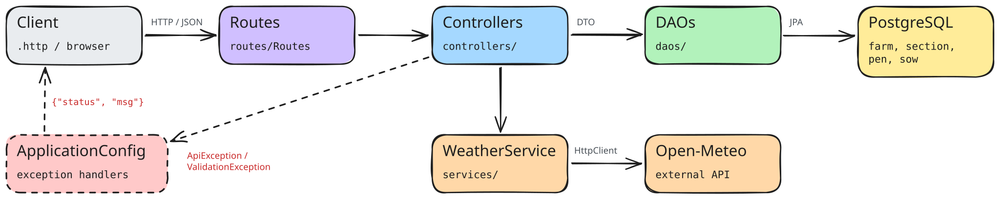
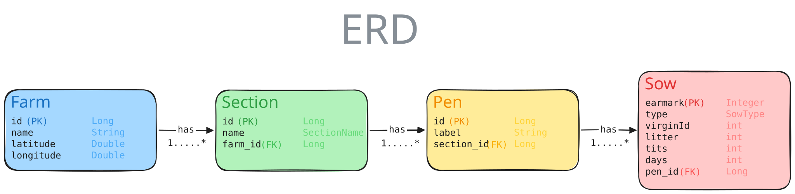

# Project Name

## Vision

> This project is a backend API for managing a farm, specifically with sows.  
> The system allows users to track, move, find etc. animals of their choice or places, like pens and sections, even farms.

---

## Links

Deployed application (optional):  
Not deployed yet

Source code repository:

https://github.com/ssvilling/04_farmview

---

# Architecture

## System Overview

The project is a layered backend built with Javalin and JPA/Hibernate. A request always travels the same way: Routes → Controller → DAO → Database, and the answer goes back the same way as JSON.

- Routes (Maps URL to controller)
- Controller layer (REST endpoints)
- DAO layer (Database work, with exceptions)
- Entities (JPA classes mapping to database)
- Enums (holds rules for some entities)
- DTO layer (Objects sent to and from the client)
- Service layer (business logic)
- Config layer (error handling, and creation of emf)

Technologies used:

- Java
- Javalin
- JPA / Hibernate
- PostgreSQL
- Maven
- Lombok
- Jackson
- SLF4J + Logback (console and file logging)
- JUnit 6, Hamcrest, Testcontainers and Rest Assured for testing
- Open-Meteo (external weather API)

---

## Architecture Diagram

---

## Key Design Decisions

I split the project into layers (routes, controllers, DAOs, entities, DTOs). Each layer has one job, so I can follow a request from the URL all the way down to the database

All my errors are handled in one place, in ApplicationConfig. The DAOs throw an ApiException with a status code and a message, and the client gets the same format back, {"status" : 404, "msg" : "No farm with id 999"}. That way the client never sees a crash or a stack trace

I never send my entities as JSON, only DTOs. My entities point at each other (a farm has sections, a section has a farm), so Jackson would keep going in circles. The DTOs only have an id or a count instead, like farmId and numberOfPens

The section type decides its pens: FARROWING always gets 55 pens with room for one sow each. The rules for the sows (an A_SOW can only be in FARROWING, a full pen can't take another sow) are checked in the DAO before anything is saved

I used these libraries: Javalin, Hibernate, Lombok, Jackson, SLF4J/Logback, JUnit, Testcontainers and Rest Assured. For the weather I used Open-Meteo, because it's free and doesn't need an API key

---

# Data Model

## ERD

Insert your Entity Relationship Diagram here.

A farm has at most one section of each type (unique constraint on farm_id + name). Pens are created with their section. Deleting a farm will delete its sections, pens and sows (cascade)

---

## Important Entities

**Farm**
A farm can be made with an optional location based on latitude and longitude. If there's no location, then no weather forecast will be shown
Fields:
- id
- name
- latitude, longitude (both or neither)

**Section**
A section is a part of the farm, each with a different functionality (though thats not fully convinced through this project, yet). It can either be MATING, GESTATION, or FARROWING
Fields:
- id
- name (SectionName enum)
- farm

**Pen**
A pen inside a section is created automatically. Each section has rules for their pens, if multiple or only one sow can be in it
Fields:
- id
- label ("LEFT"/"RIGHT", "1"-"7", "1"-"55")
- section

**Sow**
A sow is identified by her earmark. She has a type, in which two of the four are restricted to FARROWING.
Fields:
- earmark (id)
- type (GILT, SOW, A_SOW, CARE_SOW)
- virginId, litter, tits, days
- pen

# API Documentation

Describe the most important endpoints.

## Example Endpoints

### Create User

Request body:

Response:

---

### Get All Activities

Response:

---

# User Stories

1. ✅**Som** landmand **vil** jeg oprette en gård med et navn, **så** jeg kan holde styr på mine dyr. 
2. ✅**Som** landmand **vil** jeg tilføje sektioner til gården, **så** stalden er opdelt som i virkeligheden
3. ✅**Som** medarbejder **vil** jeg registrere en so med øremærke, type og boks, **så** den er registreret i systemet
4. ✅**Som** medarbejder **vil** jeg flytte en so fra stald til stald, eller ligeledes sti til sti, **så** jeg ved hvor hun står
5. 🟡**Som** landmand **vil** jeg se en liste over alle søer på gården, **så** jeg har overblik over besætningen
6. 🟡**Som** medarbejder **vil** jeg filtrere søer på sektion, type eller tilstand, **så** jeg hurtigt finder dem jeg skal arbejde med
7. ✅**Som** medarbejder **vil** jeg se hvilke bokse og stier der er tomme, **så** jeg ved hvor jeg kan placere en so
8. 🟡**Som** medarbejder **vil** jeg rette på en sos oplysninger, inklusivt slagt, død og aflivning, **så** data er korrekte og op til dags dato
9. ✅**Som** landmand **vil** jeg se temperatur, luftfugtighed og regn for gårdens placering, **så** jeg kan vurdere forholdene for dyrene
10. ❌**Som** ejer **vil** jeg have at kun medarbejdere med login kan se og ændre data, så uvedkommende ikke kan ændre i besætningen
11. ❌**Som** medarbejder **vil** jeg se de vigtigste opgaver på dags dato, såsom uddiligering af medicin, vacciner eller altresyn, **så** besætning forbliver rask og i tempo med ugens opgaver
12. ❌**Som** medarbejder **vil** jeg udregne antal A-søer nødvendige til dagens faringer, **så** grisene ikke skal slås om næringen
13. ❌**Som** driftsleder **vil** jeg se hvem der har rykket hvilke dyr, hvor og hvornår, **så** vi kan have et godt samarbejde
14. ❌**Som** medarbejder **vil** jeg se hvilke søer der skal scannes, i forhold til deres tilstand og dage, **så** vi kan finde tomme søer i tide til næste brunst

---

# Development Notes

(Optional section)

Here you can briefly describe important challenges or lessons learned during development.

Examples:

- Handling authentication with JWT
- Designing the database schema
- Structuring the service layer
- Testing the API